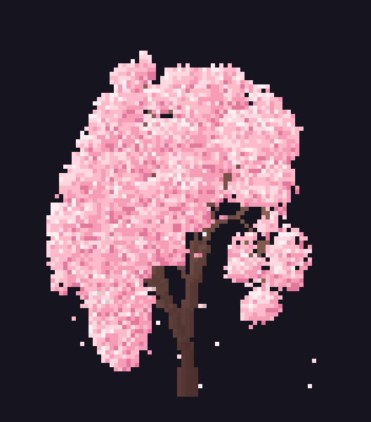

<div align="center">

# 🌸 NySakura

**A tall cherry blossom tree that grows, blooms and sheds petals, right in your terminal.**

Written in Rust · zero dependencies · made for ricing and screenshots


<br><br>



<br>

`nysakura` · `nysakura -mini` · `nysakura -blue` · `nysakura -hex ff8800`

</div>

<br>

## Contents

- 📦 [1.0 Install](#10-install)
  - [1.1 Dependencies](#11-dependencies)
  - [1.2 The installer](#12-the-installer)
  - [1.3 Update](#13-update)
  - [1.4 Uninstall](#14-uninstall)
  - [1.5 Arch Linux and the AUR](#15-arch-linux-and-the-aur)
  - [1.6 Coming from xsakura](#16-coming-from-xsakura)
- 🎨 [2.0 Usage](#20-usage)
  - [2.1 Colors](#21-colors)
  - [2.2 Tree size](#22-tree-size)
  - [2.3 Options and keys](#23-options-and-keys)
- ✨ [3.0 Ricing ideas](#30-ricing-ideas)
- ⚡ [4.0 Performance](#40-performance)
- 🛠️ [5.0 Build from source](#50-build-from-source)
- 💖 [6.0 Credits and license](#60-credits-and-license)

<br>

## 1.0 Install

The same three commands work on **every Linux distribution, Arch Linux included**:

```sh
git clone https://github.com/77nyan/nysakura.git
cd nysakura
sudo ./install.sh
```

> [!TIP]
> No git? Click **Code → Download ZIP** on this page, unzip it, open a terminal in the folder and run `chmod +x install.sh`, then `sudo ./install.sh`.

The installer shows a small menu: **1 Install · 2 Update · 3 Uninstall · 4 Quit**. Use the arrow keys or press a number. It checks your tools, builds nysakura and copies it to `/usr/local`. See [1.2](#12-the-installer).

### 1.1 Dependencies

**To run nysakura you need almost nothing:**

| | Needed | Notes |
| --- | --- | --- |
| 🐧 | Linux (any architecture) | uses only the C library that is already on your system |
| 🖥️ | A UTF-8 terminal with half-block characters `▀ ▄ █` | kitty, alacritty, foot, wezterm, konsole, gnome-terminal and so on |
| 🎨 | 24-bit color *(recommended)* | 256-color terminals work with slightly less smooth colors |

**To build it (the installer does this for you) you need:**

| | Needed | Notes |
| --- | --- | --- |
| 🦀 | **Rust 1.63 or newer** (`rustc` and `cargo`) | no other crates, nothing is downloaded while building |
| 🔧 | **A C linker** (`cc`, `gcc` or `clang`) | Rust uses it to link the program |
| 🌿 | **git** *(optional)* | only used by **Update** to download the newest version |

The installer finds what is missing and **offers to install it with your package manager**. If you prefer to do it yourself:

| Distribution | Command |
| --- | --- |
| Arch, CachyOS, Omarchy, Manjaro, EndeavourOS | `sudo pacman -S --needed rust gcc git` |
| Debian, Ubuntu, Linux Mint | `sudo apt install cargo rustc gcc git` |
| Fedora | `sudo dnf install cargo rust gcc git` |
| openSUSE | `sudo zypper install cargo rust gcc git` |
| Alpine | `sudo apk add cargo rust gcc musl-dev git` |
| Void | `sudo xbps-install -S cargo rust gcc git` |
| Gentoo | `sudo emerge dev-lang/rust-bin sys-devel/gcc dev-vcs/git` |
| Anything else | install Rust with [rustup.rs](https://rustup.rs), plus a C compiler |

> [!NOTE]
> Using **rustup**? Make sure a toolchain is set up first: `rustup default stable`.

### 1.2 The installer

`sudo ./install.sh` opens a menu in the style of the AerynOS Lichen installer:

| # | Action | What it does |
| --- | --- | --- |
| 1 | **Install** | checks the dependencies, builds nysakura, installs it to `/usr/local` |
| 2 | **Update** | downloads the newest version and reinstalls it |
| 3 | **Uninstall** | shows every file it will remove and asks first (the default answer is *No*) |
| 4 | **Quit** | leaves without changing anything |

It installs the `nysakura` command, the man page (`man nysakura`) and tab completion for bash, zsh and fish. The program is built as **your user**, so nothing in your folder becomes root-owned, and only the final copy uses root.

> [!IMPORTANT]
> Run it exactly as `sudo ./install.sh`. If it says *permission denied*, the file lost its executable bit (this happens with ZIP downloads): run `chmod +x install.sh` once.

### 1.3 Update

```sh
cd nysakura
sudo ./install.sh        # then choose  2  Update
```

It runs `git pull`, rebuilds, reinstalls, and tells you what changed: `Updated: nysakura 2.0.0 -> nysakura 2.1.0`. Check your version any time with `nysakura --version`.

<details>
<summary>📂 Downloaded the ZIP, or deleted the folder?</summary>

<br>

- **ZIP:** download the newest ZIP, unzip it, and run `sudo ./install.sh` → **Update** inside the new folder.
- **Deleted the folder:** `git clone https://github.com/77nyan/nysakura.git` again, then run the installer inside it.
- **`git pull` complains about local changes:** you edited a file in the folder. Run `git status`, undo or save your edits, and try again.

</details>

### 1.4 Uninstall

```sh
cd nysakura
sudo ./install.sh        # then choose  3  Uninstall
```

It lists every file it is about to delete and asks first. Your source folder is left alone, so delete it yourself if you don't need it. nysakura never creates config files, so nothing else is left behind.

<details>
<summary>🧹 Remove it by hand (no installer)</summary>

<br>

```sh
sudo rm -f /usr/local/bin/nysakura \
  /usr/local/share/man/man1/nysakura.1 \
  /usr/local/share/bash-completion/completions/nysakura \
  /usr/local/share/zsh/site-functions/_nysakura \
  /usr/local/share/fish/vendor_completions.d/nysakura.fish
sudo rm -rf /usr/local/share/doc/nysakura /usr/local/share/licenses/nysakura
```

</details>

### 1.5 Arch Linux and the AUR

Installing on Arch, CachyOS, Omarchy, Manjaro and EndeavourOS is **exactly the same as on every other distribution**: use the [install script](#10-install).

An **AUR package is coming soon**. When it is out you will also be able to run:

```sh
yay -S nysakura        # or: paru -S nysakura
```

(a capital `S`). Until then, the installer is the way.

### 1.6 Coming from xsakura

nysakura is the Rust rewrite of **xsakura**, the earlier Python tool, with the same options and a new name. Run the installer: it finds the old `xsakura` files and offers to remove them. If xsakura came from the AUR, remove it with `sudo pacman -Rns xsakura`.

<br>

## 2.0 Usage

```sh
nysakura               # a tall pink tree, made for full-height terminals
nysakura -mini         # a shorter, wider tree
nysakura -red          # any color
nysakura -s 12 -i      # an already grown tree, the same one every time
```

### 2.1 Colors

Give a color as a single-dash option:

`-sakura` *(default)* · `-pink` · `-red` · `-orange` · `-yellow` · `-gold` · `-green` · `-cyan` · `-blue` · `-purple` · `-magenta` · `-white` · `-rainbow` · or any color with `-hex ff8800`

Run `nysakura --list` to see them in your terminal.

### 2.2 Tree size

| Option | Tree |
| --- | --- |
| *(default)* | 🌲 **tall and slim**: a long trunk and a narrow crown that fills about 90% of the terminal height. Best in a full-height window. |
| `-mini` | 🌳 **short and wide**: a short trunk and a round crown. Best in a short or wide terminal. |

The tree always shrinks to fit the window. `--scale X` makes it bigger or smaller.

### 2.3 Options and keys

| Option | What it does |
| --- | --- |
| `-s`, `--seed N` | reproducible tree (same seed and window size = same tree) |
| `-p`, `--print` | print the finished tree and exit, great for screenshots |
| `-i`, `--instant` | skip the growing animation |
| `-t`, `--time SEC` | quit after SEC seconds |
| `--cycle SEC` | grow a new tree SEC seconds after the last one finished |
| `--speed X` | animation speed (default 1.0) |
| `--grow SEC` | how long the tree needs to grow (default 9) |
| `--petals N` | number of falling petals |
| `--wind X` | wind strength, negative blows left |
| `--scale X` | tree size multiplier |
| `--width N`, `--height N` | size in cells instead of the terminal size |
| `--fps N` | frames per second (default 30) |
| `--truecolor`, `--256` | force the color mode |
| `-l`, `--list` · `-h`, `--help` · `-v`, `--version` | list colors · help · version |

**Keys while it runs:** <kbd>q</kbd> or <kbd>Esc</kbd> quit · <kbd>r</kbd> grow a new tree · <kbd>Space</kbd> pause

<br>

## 3.0 Ricing ideas

```sh
# screensaver: a new tree every 30 seconds after the last one is done
nysakura --cycle 30

# an already grown tree for your wallpaper terminal
nysakura -i -s 12

# greet yourself in ~/.bashrc or ~/.zshrc  (fish: config.fish)
nysakura -p --height 14

# hyprland / sway / niri: a terminal on a scratch workspace
kitty --class nysakura -e nysakura --cycle 60
```

<br>

## 4.0 Performance

nysakura is a full rewrite in Rust. Same trees, same options, a lot less work for your machine:

| Measured (8 seconds, live) | xsakura (Python) | nysakura (Rust) |
| --- | --- | --- |
| Peak memory, 120×40 terminal | 23.7 MB | **3.1 MB** |
| Peak memory, 250×70 terminal | 65.9 MB | **8.1 MB** |
| CPU time, 120×40 terminal | 0.33 s | **0.03 s** |
| CPU time, 250×70 terminal | 2.50 s | **0.11 s** |
| `--print`, 200×60 | 0.58 s | **0.05 s** |
| Needs | Python 3 | nothing |

<sub>Measured on one x86_64 Linux test machine. Yours will differ, but the ratio should hold.</sub>

**Made for older devices:** one 400 KB binary with no dependencies, only the cells that changed are redrawn, 256-color fallback, and `--fps 15` lowers the load even more. Built and tested with Rust 1.97. The code only uses features from Rust 1.63, checked with clippy's MSRV lint, and CI builds it with 1.63 too.

<br>

## 5.0 Build from source

```sh
git clone https://github.com/77nyan/nysakura.git
cd nysakura
cargo build --release        # the program is target/release/nysakura
cargo test                   # run the tests
./target/release/nysakura
```

<br>

## 6.0 Credits and license

Made by **Jakub Ziaja** ([@77nyan](https://github.com/77nyan)). Released under the [MIT license](LICENSE).

<div align="center">

🌸 *If you like it, a star on GitHub makes my day.*

</div>
